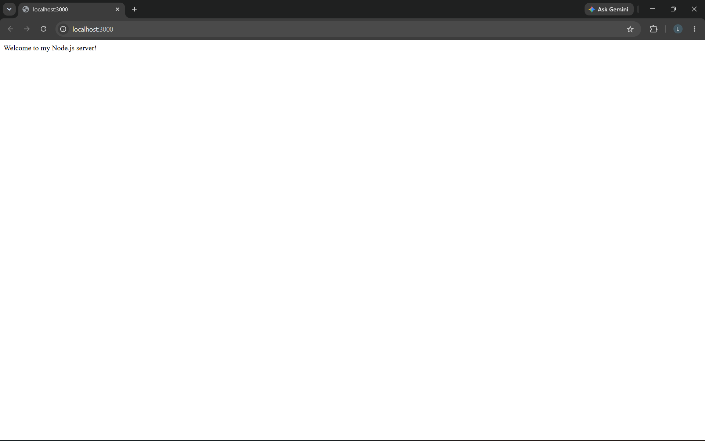
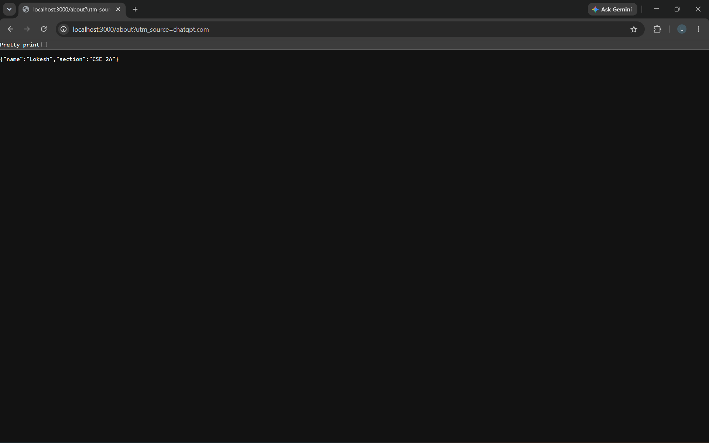
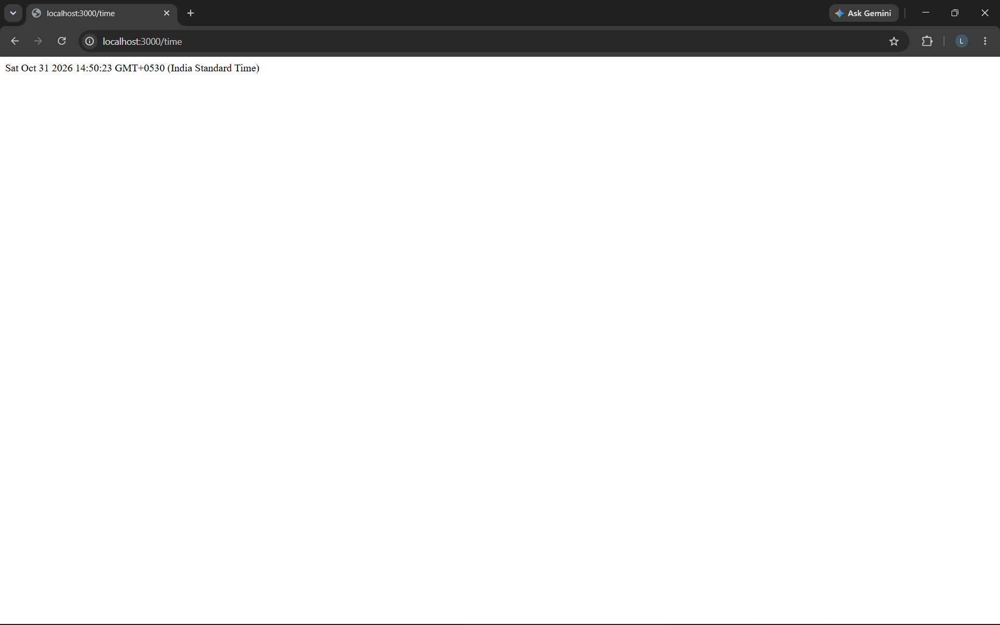
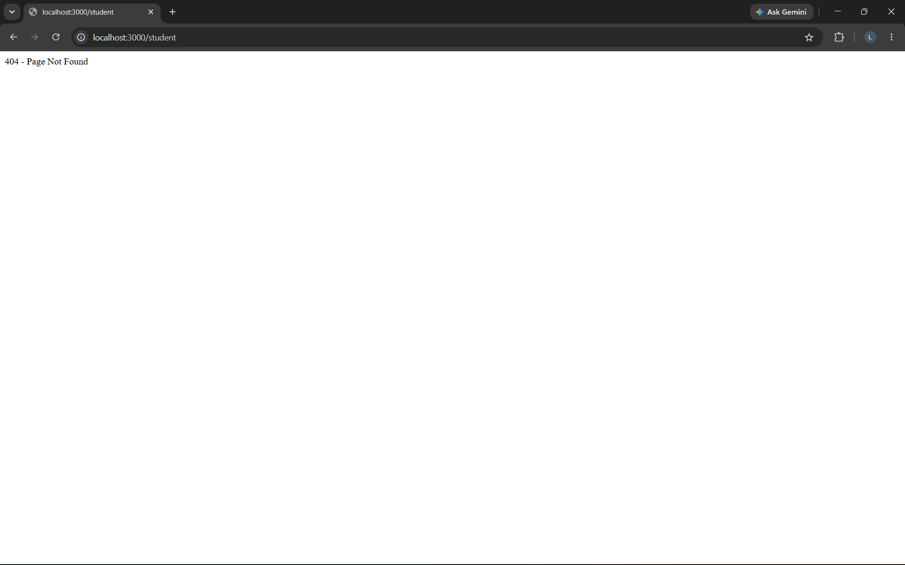
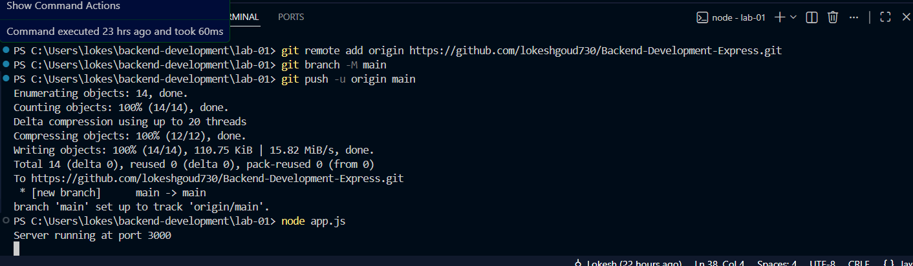

# Lab 1: Node.js and Express Server

## Student Details

- Name: Lokesh
- Registration Number: 252U1R1047
- Section: CSE 2A
- Course: Backend Development Fundamentals
- College: Aurora

## Live Link

Not deployed yet.

## Project Description

This project demonstrates the fundamentals of Node.js and Express.js.

It includes a basic HTTP server using the built-in Node.js HTTP module and an Express server with multiple GET routes.

## Technologies Used

- Node.js
- Express.js
- JavaScript
- npm

## Project Structure

```text
lab-01/
├── screenshots/
│   ├── 01-home.png
│   ├── 02-about.png
│   ├── 03-time.png
│   ├── 04-not-found.png
│   └── 05-terminal.png
├── app.js
├── server-http.js
├── package.json
├── package-lock.json
└── README.md
```

## How to Run

### Prerequisites

- Node.js installed
- npm installed

### Installation

1. Clone the GitHub repository.

```bash
git clone https://github.com/lokeshgoud730/Backend-Development-Express.git
```

2. Navigate to the lab folder.

```bash
cd Backend-Development-Express/lab-01
```

3. Install dependencies.

```bash
npm install
```

4. Start the application.

```bash
npm start
```

The server runs on port 3000 by default.

## Endpoints

| HTTP Method | Endpoint | Description | Status |
|---|---|---|---|
| GET | / | Displays welcome message | 200 |
| GET | /about | Returns student name and section | 200 |
| GET | /time | Returns current date and time | 200 |
| GET | /student | Demonstrates unknown route handling | 404 |

## Screenshots

### 1. Home Route



### 2. About Route



### 3. Time Route



### 4. 404 Not Found



### 5. Terminal Status Codes



## Concepts Learned

1. Initializing a Node.js project using npm.
2. Understanding package.json and node_modules.
3. Creating a server using the Node.js HTTP module.
4. Creating a server using Express.js.
5. Creating GET routes.
6. Understanding request and response objects.
7. Using middleware.
8. Handling unknown routes using HTTP 404.
9. Logging HTTP status codes.

## Problems Faced and Solutions

- Learned how to configure a Node.js project.
- Understood the difference between HTTP module and Express.
- Practiced creating routes and handling responses.
- Implemented middleware for status-code logging.

## Environment Variables

No environment variables are required for local execution.